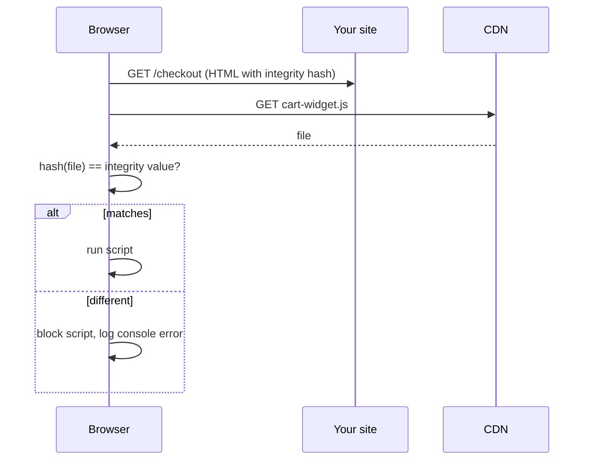

# 🔏 Subresource Integrity (SRI)

> Subresource Integrity (SRI) lets the browser check that a script or stylesheet loaded from another site is exactly the file you expected. If the file was changed, the browser refuses to run it.

---

## 1. What is it?

Many pages load files from other sites, such as a script from a Content Delivery Network (CDN). A CDN is a network of servers that delivers files quickly.

The risk: if that CDN, or the account that publishes the file, is hacked, the file can be replaced with a malicious one. Your page would then run the attacker's code for every visitor.

SRI fixes part of this. You add a **hash** (a short fingerprint of the file) to the `<script>` or `<link>` tag. The browser downloads the file, computes its fingerprint and compares. If they differ, the file is blocked.

## 2. Why it matters

- A changed third-party script can steal logins, card details and session data on your checkout page.
- Real incidents have happened where popular CDN-hosted scripts were tampered with and ran on thousands of sites.
- SRI is cheap to add and needs no server changes.

## 3. How it works



The hash is written as `algorithm-base64value`, for example `sha384-...`. Browsers support SHA-256, SHA-384 and SHA-512. SHA-384 is the common choice.

## 4. A simple example

Without SRI (risky if the CDN is compromised):

```html
<script src="https://cdn.example.com/cart-widget@1.4.2/cart-widget.min.js"></script>
```

With SRI:

```html
<script
  src="https://cdn.example.com/cart-widget@1.4.2/cart-widget.min.js"
  integrity="sha384-REPLACE_WITH_REAL_HASH"
  crossorigin="anonymous"></script>
```

**Important lines:**
- `integrity` holds the expected hash. (The value above is a placeholder, so generate your own.)
- `crossorigin="anonymous"` is needed for files from another origin. The browser fetches them using CORS (Cross-Origin Resource Sharing), and the CDN must send an `Access-Control-Allow-Origin` header. Without it, the browser cannot check the file and blocks it.

### Generate the hash

```bash
curl -s https://cdn.example.com/cart-widget@1.4.2/cart-widget.min.js \
  | openssl dgst -sha384 -binary \
  | openssl base64 -A
```

Put `sha384-` in front of the output. Use a **pinned version** URL (like `@1.4.2`), not `latest`.

## 5. Common mistakes

- **Using SRI on a URL whose content changes** (`/latest/lib.js`). The hash stops matching and the page breaks.
- **Forgetting `crossorigin`.** The script fails to load.
- **Believing SRI makes a third-party script safe.** It only proves the file is the same one you reviewed. If the file was already malicious when you hashed it, SRI will not help.
- **Computing the hash from an untrusted source** or from a different version than you deploy.
- **Using SRI on scripts that load other scripts.** Scripts loaded later by that script are not covered.
- **Services that change files per visitor** (for example, some analytics, ad and tag-manager scripts) cannot use SRI.

## 6. How to do it safely

1. Prefer **self-hosting** important scripts (host the file on your own domain, installed through npm). This removes the third party.
2. When you must use a CDN, **pin the exact version** and add `integrity` + `crossorigin`.
3. **Automate the hash.** Build tools can add it for you, for example the `webpack-subresource-integrity` plugin, or generate it in your build step.
4. Combine with a **Content Security Policy (CSP)** to restrict where scripts can load from.
5. **Review updates.** When you upgrade a library, review the change and regenerate the hash.
6. Keep dependencies under control with lockfiles and dependency scanning.

**Limits:** SRI works for `<script>` and `<link rel="stylesheet">` (and `rel="preload"` / `modulepreload`). It does not protect dynamic `import()` or `fetch()` by itself, and it does not protect scripts inserted by other scripts.

## 7. How to test it

1. Load your page and open DevTools → **Network** to confirm the file loads (status `200`).
2. **Break the hash on purpose** in a local copy (change one character). Reload. The browser should block the script and show a console error mentioning `integrity`.
3. Remove `crossorigin` locally and confirm you understand the failure.
4. In CI, check that every external `<script src="https://...">` and `<link>` has `integrity`. A simple check:

```bash
grep -rnE '<script[^>]+src="https?://' dist/ | grep -v integrity
```

If this prints a line, a third-party script is missing SRI.

## 8. 📋 Code review checklist

- [ ] Every external script and stylesheet has `integrity` and `crossorigin`.
- [ ] URLs are pinned to an exact version (no `latest`).
- [ ] Hashes are generated from the reviewed file, ideally in the build.
- [ ] A CSP limits script sources.
- [ ] Critical scripts are self-hosted where possible.

## 9. Interview questions

1. **What problem does SRI solve?** It detects when a third-party file was modified.
2. **Why is `crossorigin="anonymous"` needed?** The browser must fetch the file with CORS so it is allowed to read the bytes and hash them.
3. **Does SRI stop a malicious script?** No. It only confirms the file matches the hash. You still need to trust the original file.
4. **Why does SRI break with `/latest/` URLs?** The file changes, so the hash no longer matches.
5. **How do SRI and CSP work together?** CSP limits *where* resources come from. SRI checks *what* the content is.

## 10. Quick revision

- SRI = hash in `integrity` attribute. Browser blocks the file if it does not match.
- Needs `crossorigin="anonymous"` and CORS headers from the CDN.
- Pin versions. Do not use on files that change.
- Does not make a bad script safe. Self-host when you can.
- Pair with CSP.

## 11. Useful references

- [MDN: Subresource Integrity](https://developer.mozilla.org/en-US/docs/Web/Security/Subresource_Integrity) — clear guide with examples and browser behavior.
- [W3C SRI specification](https://www.w3.org/TR/SRI/) — the official standard.
- [OWASP: Third Party JavaScript Management Cheat Sheet](https://cheatsheetseries.owasp.org/cheatsheets/Third_Party_Javascript_Management_Cheat_Sheet.html) — wider advice on third-party scripts.
- [MDN: Content Security Policy](https://developer.mozilla.org/en-US/docs/Web/HTTP/CSP) — the policy that works alongside SRI.

---

🏠 [HTTP, Network & Headers Home](README.md)
